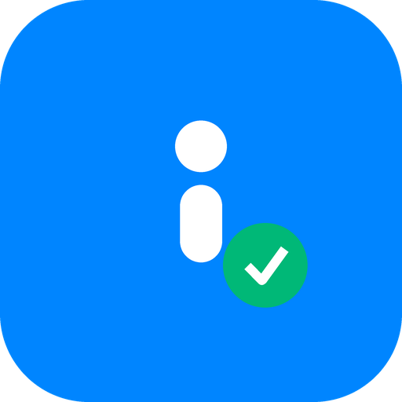

# IDroot Authenticator

<br>

**IDroot Authenticator** is a free, open source 2FA app for Android.
One-time codes and short notes stay on the device, in an encrypted vault.
It is a fork of [Aegis Authenticator](https://github.com/beemdevelopment/Aegis)
with added functions, and it keeps that vault format, so Aegis backups still import.
Code exports stay compatible: notes are not included in them.

Website: [idroot.org](https://idroot.org)

This project is not affiliated with Beem Development. The Aegis name and logo
belong to their authors. Source is GPL-3; see [LICENSE](LICENSE).

For a list of frequently asked questions, please check out [the FAQ](FAQ.md).

The security design of the app and the vault format is described in detail in
[this document](docs/vault.md).

## Features

- Free and open source
- Secure
  - The vault is encrypted (AES-256-GCM), and can be unlocked with:
    - Password (scrypt)
    - Biometrics (Android Keystore)
  - Screen capture prevention
  - Tap to reveal
- Secure notes
  - Short notes, such as Wi-Fi passwords, in the same vault
  - Export and import notes separately from the codes
- Compatible with Google Authenticator
- Supports industry standard algorithms:
  [HOTP](https://tools.ietf.org/html/rfc4226) and
  [TOTP](https://tools.ietf.org/html/rfc6238)
- Lots of ways to add new entries
  - Scan a QR code or an image of one
  - Enter details manually
  - Import from other authenticator apps: 2FAS Authenticator, Authenticator
    Plus, Authy, andOTP, FreeOTP, FreeOTP+, Google Authenticator, Microsoft
    Authenticator, Plain text, Steam, TOTP Authenticator and WinAuth (root
    access is required for some of these)
- Organization
  - Alphabetic/custom sorting
  - Custom or automatically generated icons
  - Group entries together
  - Advanced entry editing
  - Search by name/issuer
- Material design with multiple themes: Light, Dark, AMOLED
- Export (plaintext or encrypted)
- Automatic backups of the vault to a location of your choosing

## Screenshots

[](metadata/en-US/images/phoneScreenshots/screenshot1.png?raw=true)
[](metadata/en-US/images/phoneScreenshots/screenshot2.png?raw=true)
[](metadata/en-US/images/phoneScreenshots/screenshot3.png?raw=true)

## Downloads

Not published on the Play Store or F-Droid yet. When a signed build exists it
will be attached to a GitHub Release of this repository and linked from
[idroot.org](https://idroot.org).

Do not install the official Aegis APK expecting this branding. IDroot
Authenticator uses its own application id (`org.idroot.authenticator`) and its
own signing key. This is not the Aegis key.

### Verification

Release APKs are signed with the IDroot release key, alias `idroot`.

```
apksigner verify --print-certs --verbose idroot-authenticator.apk
```

```
Owner: CN=IDroot Authenticator, O=IDroot, C=EC
Valid until: Mon Apr 06 18:42:15 UTC 2054
SHA1: C3:6F:3E:04:F3:EB:22:5F:0B:5E:F9:BE:A1:7C:9B:A5:30:3C:B9:87
SHA256: 5E:4A:D4:D4:84:AF:36:C8:66:B5:9C:FF:4A:54:09:8E:CC:7E:30:05:64:E4:E7:3F:B9:B8:14:9C:1A:20:63:2C
```

## Legal

The app is separate from the idroot.org handle service. Its own texts, with the German version authoritative:

- [Privacy policy](docs/legal/privacy.en.md) · [Datenschutzerklärung](docs/legal/privacy.de.md)
- [Terms of use](docs/legal/terms.en.md) · [Nutzungsbedingungen](docs/legal/terms.de.md)

The website policies do not describe this app. The app does not create an account and has no internet permission.

### Icon packs

Aegis supports icon packs to make it easier to assign icons to the entries in
your vault. There are no official icon packs, but the community maintains a
number of third-party icon packs you may want to check out. To learn how to
create your own Aegis-compatible icon pack, see [the
documentation](docs/iconpacks.md).

- [aegis-icons](https://github.com/aegis-icons/aegis-icons)

  Unofficial monochrome-styled 2FA icons.

  [](https://github.com/aegis-icons/aegis-icons)

- [delta-aegis-icons](https://github.com/Delta-Icons/aegis-icons)

  Delta version of the unofficial monochrome-styled 2FA icon pack aegis-icons.

  [](https://github.com/Delta-Icons/aegis-icons)

- [aegis-simple-icons](https://github.com/alexbakker/aegis-simple-icons) \*

  This project periodically generates an icon pack for Aegis based on [Simple
  Icons](https://simpleicons.org/).

  [](https://github.com/alexbakker/aegis-simple-icons)

- [aegis-simple-icons-outlined](https://github.com/michaelschattgen/aegis-simple-icons-outlined) \*

  This is a variant on the aegis-simple-icons pack where the icons contain no solid background and just the outlines are being used.

  [](https://github.com/michaelschattgen/aegis-simple-icons-outlined)

\* The icons are automatically generated, so
not all of them are as high quality as the ones you'll find in
[aegis-icons](https://github.com/aegis-icons/aegis-icons).

## Contributing

Issues and pull requests for this fork are welcome on
[GitHub](https://github.com/arcanis2k3/Authenticator).
Please keep the GPL-3 license and the Aegis copyright notices intact.
Upstream development still happens at
[beemdevelopment/Aegis](https://github.com/beemdevelopment/Aegis).

## License

This project is licensed under the GNU General Public License v3.0. See the
[LICENSE](LICENSE) file for details.

A couple of libraries vendored in Aegis' repository are licensed under a
different license:

- [TextDrawable](app/src/main/java/com/amulyakhare/textdrawable)
- [TrustedIntents](app/src/main/java/info/guardianproject/trustedintents)
